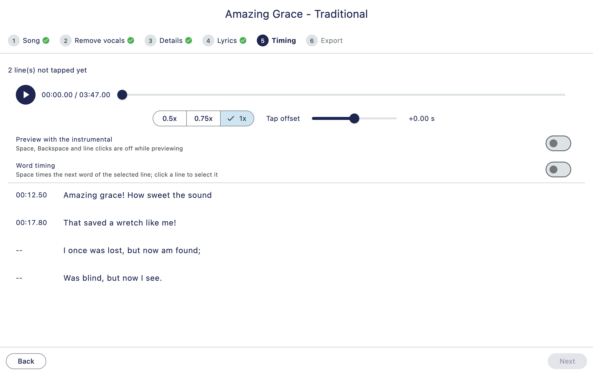
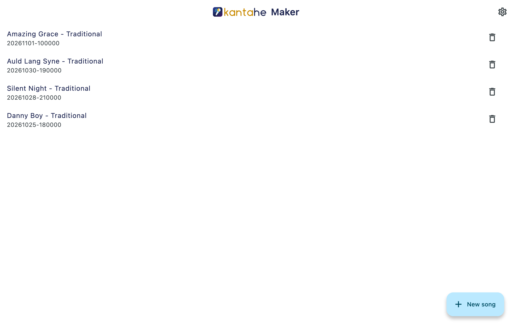
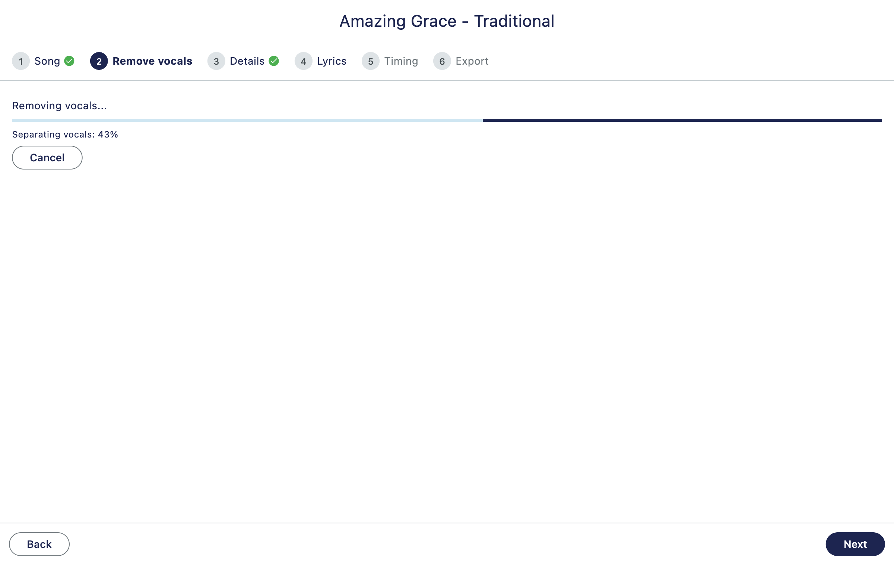
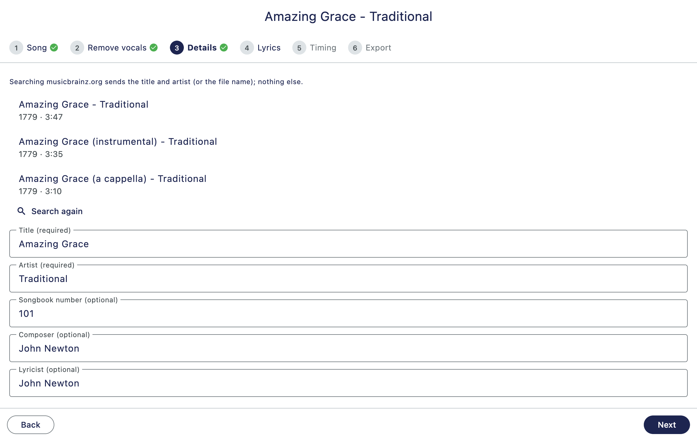
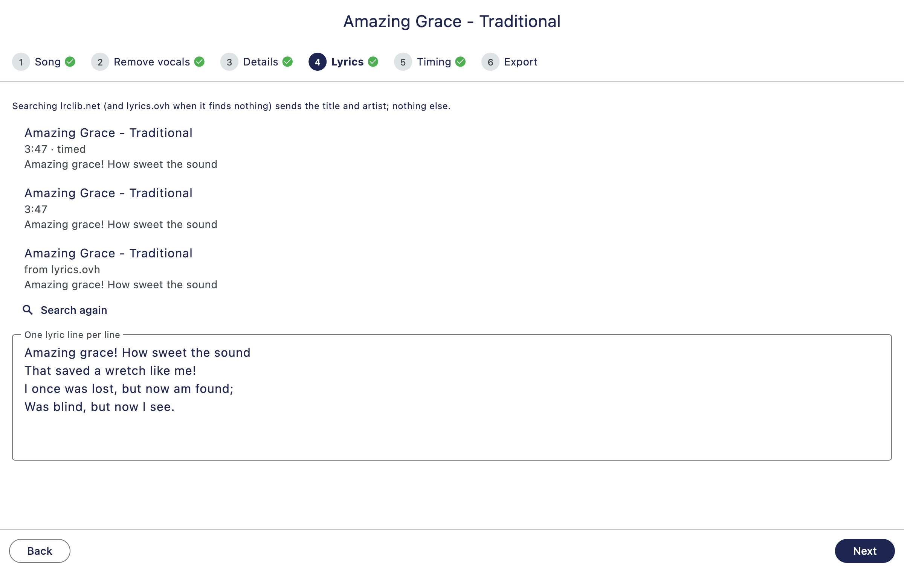
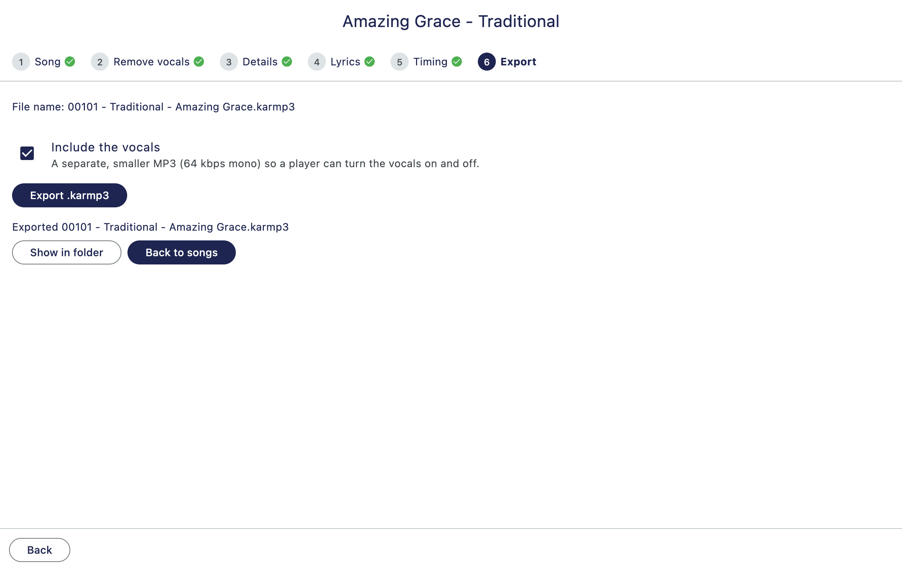
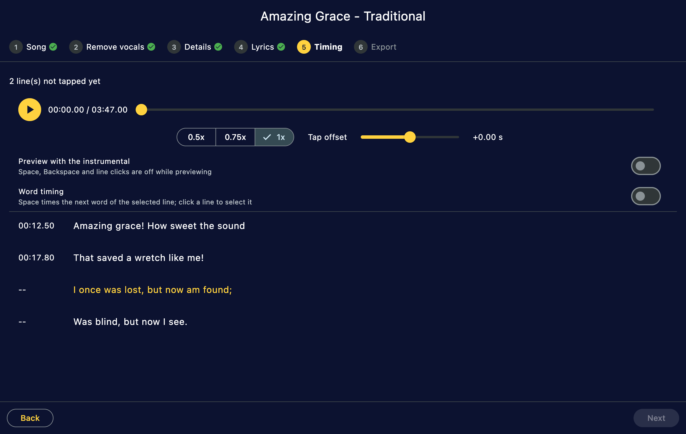

<picture>
  <source media="(prefers-color-scheme: dark)" srcset="assets/branding/lockup-dark.png">
  
</picture>

# Kantahe Maker

**Make your own karaoke files.** Pick a song and Kantahe Maker takes the vocals out, finds the lyrics, lets you time them by tapping along, and saves it all in one `.karmp3` file. Everything happens on your own computer.

The app's domain is kantahe.party.



*The screenshots show a demo song in the public domain; the lists of matches and lyrics are examples.*

## Why Kantahe Maker

- **Free and open source** (MIT license).
- **Vocals removed on your computer** by AI models. Your music is never uploaded.
- **Lyrics and song details found for you**, or type and paste your own.
- **Tap along to time the lyrics**, at half speed if you like, even word by word.
- **Vocals on or off:** tick one box to add the singer's track as a separate, smaller MP3, so a player can switch it on and off.
- **macOS, Windows and Linux.**

## Download

Get the latest version from the [releases page](https://github.com/andrewloable/kantahe-maker/releases/latest):

- **macOS** (12 or newer, Apple silicon and Intel): `kantahe-maker-<version>-macos.zip`. The app is not signed: the first time, right-click it and choose **Open**.
- **Windows**: `kantahe-maker-<version>-windows.zip`. SmartScreen warns about unsigned apps: choose **More info**, then **Run anyway**.
- **Linux**: `kantahe-maker-<version>-linux.tar.gz`. It needs libmpv (`libmpv2` or `libmpv1`).

The first time, the app asks before it downloads the tools it needs (ffmpeg, Python with the vocal-removal software, and the model): about 1.4 GB, once.

## How it works

Click **New song** and pick an audio or video file (an .mp3 or .mp4, for example). Six steps follow, one screen each.

**1. Song.** The app reads your file.



**2. Remove vocals.** The singer is taken out, in the background: carry on meanwhile.



**3. Details.** Title and artist come from the file; pick a match for composer and lyricist. If nothing is found, the search is tried again with title and artist swapped, in case the file is named "Title - Artist".



**4. Lyrics.** Pick a result, or paste your own. "Timed" results come with line times. As in Details, a search that finds nothing is tried again with title and artist swapped.



**5. Timing.** Play the song and press Space as each line starts.


**6. Export.** Choose whether to include the vocals and save the `.karmp3`.



## Your privacy

Your songs stay on your computer. The app sends only a few words, only to these services, and each step shows what it sends:

- **Details:** the title and artist (or the file name) go to musicbrainz.org.
- **Lyrics:** the title and artist go to lrclib.net, and to lyrics.ovh when lrclib.net finds nothing.
- **Tools:** with your consent, about 1.4 GB once (see Download).

Nothing else leaves your computer. There is no account.

## FAQ

**Which files can I use?** Audio or video files: .mp3, .mp4, .m4a, .mkv, .webm, .wav and .flac.

**How long does vocal removal take?** It depends on your computer and the song. It runs in the background, so you can fill in the details and lyrics meanwhile.

**Where are my songs saved?** In the app's folder for your user (on macOS: `~/Library/Application Support/party.kantahe.maker/projects`), saved as you go. The `.karmp3` goes where you choose. Delete a song from the list on the home screen.

**What is a .karmp3?** A karaoke file: a ZIP with the song without its vocals, the lyrics with times, the song details and, if you chose it, the vocals. The format is open and described [below](#the-karmp3-format).

**Light and dark?** The app follows your computer's setting.

**Does it work with a screen reader?** No. The Flutter engine the app is built on can crash on macOS when a screen reader (or another tool that reads the screen) is running, so the app does not offer its contents to them.



## For developers

Kantahe Maker is a Flutter desktop app. See `PLAN.md` for how it works and `CLAUDE.md` for how it is built. The `.karmp3` format is specified [below](#the-karmp3-format). License: MIT (see `LICENSE`).

```bash
flutter pub get
flutter analyze             # must be clean
flutter test                # unit tests
flutter run -d macos        # or -d linux / -d windows on those hosts
flutter build macos         # release build (linux/windows on their own hosts)
```

### Building releases

The GitHub Actions workflow `.github/workflows/build.yml` builds the app on macOS,
Linux and Windows (each OS on its own runner) when a release is published on GitHub (a
draft release does not start it) and attaches `kantahe-maker-<tag>-macos.zip`,
`-linux.tar.gz` and `-windows.zip` to that release. A manual run (workflow_dispatch)
only keeps the archives as workflow artifacts. It never creates a release, pushes or
tags: you do that by hand.

- macOS builds are unsigned: the first time, right-click the app and choose Open.
- Windows shows a SmartScreen warning for an unsigned app.
- Linux needs libmpv at runtime (`libmpv2` or `libmpv1`, depending on the distro).
- The tools the app needs (ffmpeg, uv, the vocal-removal model) are not bundled: the app
  downloads them after asking for consent.

## The .karmp3 format

This section is the specification of the `.karmp3` file, for developers and AI agents who
want to build other programs that read or write it (players, converters, editors). It is the
source of truth: the code that writes the format is checked against the examples below by a
test (`test/readme_format_test.dart`).

A `.karmp3` is a **ZIP archive** with an instrumental MP3 (the song without its vocals), the
lyrics timed line by line (and, optionally, word by word), and the song's details. Since
version 1.1.0 it can also hold the vocals as a separate MP3, so a player can switch them on
and off.

| Version that wrote the file | What is in it |
|---|---|
| 1.0.x | `NAME.mp3`, `NAME.lrc`, `NAME.nfo`. The `.nfo` has no `Instrumental` row. The instrumental is 192 kbps and not normalized |
| 1.1 and later | The same, and the `.nfo` always has an `Instrumental` row. `NAME.vocals.mp3` is added when the user chose to include the vocals. The instrumental is 128 kbps for songs processed by 1.1 (192 kbps for songs processed earlier); both MP3s are normalized to about -16 LUFS |
| 1.2.0 only | The same, but both MP3s are variable bitrate (the instrumental averages about 96 kbps, the vocals about 48 kbps) with a Xing header. The `Audio` and `Vocals audio` rows say "average (VBR)". Players that use a browser's audio element play the vocals late after a seek (see "Constant bitrate") |
| 1.2.1 and later | The same, with constant-bitrate MP3s: the instrumental 96 kbps and the vocals 48 kbps, both with an Info header (frame count and seek table). The `Audio` and `Vocals audio` rows say the plain bitrate |

### Files in the archive

| Entry | Content |
|---|---|
| `NAME.mp3` | the **instrumental**: the song with its vocals removed (MP3, 44.1 kHz, stereo) |
| `NAME.lrc` | the lyrics with times: tag lines, then one timed line per lyric line (see "The .lrc file") |
| `NAME.nfo` | the song's details as aligned `Key : value` lines (see "The .nfo file") |
| `NAME.vocals.mp3` | optional, only when the user included the vocals: the vocals alone (MP3, 44.1 kHz, 48 kbps, mono), with the same length and start as `NAME.mp3`, so a player can play the two together in step |

- **`NAME`** is `NNNNN - Artist - Title` when the song has a songbook number (padded to 5
  digits), and `Artist - Title` when it has not. Artist and title are cleaned the same way:
  the characters `\ / : * ? " < > |` and control characters become spaces, runs of white
  space become one space, spaces and dots are trimmed from both ends, the result is cut to
  80 characters, and an empty result becomes `Unknown`. The file on disk is `NAME.karmp3`.
- **Order of the entries**: `NAME.mp3`, `NAME.lrc`, `NAME.nfo`, then `NAME.vocals.mp3` when
  present. The vocals come last, so a reader that simply takes the first `.mp3` gets the
  instrumental.
- **ZIP details**: deflate compression; every entry's modified time is 1980-01-01 00:00 and
  the `.nfo` holds no date, so the same input always gives the same bytes; text files are
  UTF-8 with `\n` line ends; names are UTF-8.
- **Loudness**: since 1.1.0 both MP3s are normalized to about -16 LUFS each, so the vocals
  are as loud as the instrumental, not at their original level. A player that mixes them may
  want to lower the vocals. Older files are not normalized.
- **Constant bitrate**: since 1.2.1 the instrumental is 96 kbps and the vocals 48 kbps (128 and
  64 kbps in 1.1; 1.2.0 was the exception, see below), all constant bitrate (the `.nfo` rows
  say so). Each starts with an Info tag in its first frame
  that holds the number of frames and bytes and a 100-entry seek table; take the exact length
  from the frame count (1152 samples per frame at 44.1 kHz). A writer must not use variable
  bitrate: a browser's audio element seeks in a variable-bitrate MP3 up to about 1.4 s away
  from the asked time while `currentTime` still reports the asked time (measured in Chromium),
  so the vocals and the lyrics fall out of step after every seek. Constant-bitrate files seek
  exactly. Version 1.2.0 did write variable-bitrate files (a Xing tag instead of Info, the
  average from its counts); a reader may meet them, and a song is made again by running its
  vocal removal again.
- **Nothing else** goes in the archive (no video, no original audio). A reader should ignore
  entries it does not know.
- **Times** in the `.lrc` count from the start of `NAME.mp3` (and of `NAME.vocals.mp3`, which
  starts at the same moment). They already include the tap offset the user chose in the
  maker; a player applies no offset of its own.

### The .lrc file

```
[ti:TITLE]
[ar:ARTIST]
[au:COMPOSER]            (only when a composer is given)
[mm:ss.xx]lyric line     (one per lyric line)
```

- Tag lines match `^\[([A-Za-z]+):(.*)\]$`. `ti` and `ar` are always there, `au` (the
  composer) only when one is given. The title, artist and composer are on one line each.
- A **timestamp** is `mm:ss.xx`: minutes padded to at least 2 digits, then seconds with two
  decimals padded to 5 characters (`07.31`). The time is rounded to whole hundredths of a
  second first, so 59.996 s is written `01:00.00`. Negative times are written as `00:00.00`.
- A lyric line with **line timing** is `[mm:ss.xx]text`. Match it with
  `^\[(\d{2,}):(\d{2}\.\d{2})\](.*)$`.
- A lyric line with **word timing** is `[mm:ss.xx]` followed by the words, each preceded by
  its own `<mm:ss.xx>` mark; the first mark equals the line's time. A word keeps the space
  that follows it. Match a mark with `<(\d{2,}):(\d{2}\.\d{2})>`. A line without marks counts
  as one word at the line's time, so a reader can treat both kinds alike.
- Blank lyric lines are not written. Lines are in playing order and their times do not go
  backwards.

### The .nfo file

Each line is `Key`, spaces, ` : `, and the value; keys are padded with spaces to the length of
the longest key (`Vocals removed`, 14 characters), so the colons line up. Match a line with
`^(.+?)\s+:\s(.*)$`. Rows with an empty value are left out. The rows come in this order
(a reader should look rows up by key, ignore keys it does not know, and not rely on the
order or on a row being there unless the table says "always"):

| Key | Present | Value |
|---|---|---|
| `Title` | always | the title, on one line |
| `Artist` | always | the artist, on one line |
| `Song number` | when the song has a songbook number | the number, without padding (`101`) |
| `Composer` | when given | the composer |
| `Lyricist` | when given | the lyricist |
| `Duration` | always | `m:ss`, rounded to whole seconds (`3:47`) |
| `Audio` | when the instrumental could be read | what the instrumental really is: `MP3, 44.1 kHz, 96 kbps` (`128 kbps` in files made by 1.1, `192 kbps` from songs processed by 1.0.x; `MP3, 44.1 kHz, 95 kbps average (VBR)` in files made by 1.2.0, the average from the Xing tag) |
| `Vocals removed` | always | the name of the model that removed the vocals (`UVR-MDX-NET-Inst_HQ_3`) |
| `Instrumental` | always in files made by 1.1 and later | the name of the instrumental's entry in the archive (`NAME.mp3`) |
| `Vocals` | only when the vocals are included | the name of the vocals' entry (`NAME.vocals.mp3`) |
| `Vocals audio` | only when the vocals are included and could be read | what the vocals really are, in the same words as `Audio` and then the channels: `MP3, 44.1 kHz, 48 kbps, mono` (`64 kbps` in files made by 1.1, `46 kbps average (VBR)` and the like in files made by 1.2.0) |
| `Lyrics` | always | `timed (.lrc, N lines)` |
| `Lyric timing` | always | where the times come from: `tapped by hand in Kantahe Maker`, or `from lrclib.net synced lyrics` (times that came with the lyrics and were not changed), or `from lrclib.net synced lyrics, corrected by hand in Kantahe Maker` |

### Reading a .karmp3

1. Open the file as a ZIP archive.
2. Find the `.lrc` and the `.nfo` entries by their extension.
3. Parse the `.nfo` into key/value pairs with `^(.+?)\s+:\s(.*)$`.
4. The **instrumental** is the entry whose name is the value of `Instrumental`. If there is
   no such row (a file made by 1.0.x), it is the only `.mp3` entry.
5. The **vocals** are the entry whose name is the value of `Vocals`. If there is no such row
   there are no vocals: do not offer a vocals switch.
6. Parse the `.lrc`: the tags, then the timed lines (with their word marks, if any).
7. Play the instrumental and show the lyrics at their times. When the user turns the vocals
   on, start `NAME.vocals.mp3` at the same moment and keep the two in step (seek and pause
   both together); the vocals are at the same loudness as the instrumental, so offer a
   volume control for them.

### Writing a .karmp3

1. Build `NAME` as described above and write `NAME.mp3` (44.1 kHz stereo MP3, no tags,
   96 kbps constant bitrate with an Info tag, normalized to about -16 LUFS). With vocals,
   write `NAME.vocals.mp3` the same length (mono, 44.1 kHz, 48 kbps constant bitrate with an
   Info tag, same loudness). With ffmpeg: `-c:a libmp3lame -b:a 96k` (`48k` for the vocals;
   ffmpeg writes the Info tag by itself); no `-abr` or `-q:a`.
2. Write `NAME.lrc` with the tag lines and the timed lines, using the timestamp rules above.
3. Write `NAME.nfo` with the rows above in that order. Always write `Instrumental`; write
   `Vocals` and `Vocals audio` only when the vocals entry is in the archive. Describe the
   instrumental in `Audio` as it is.
4. Add the entries in the order `.mp3`, `.lrc`, `.nfo`, `.vocals.mp3`, deflated, with the
   modified time 1980-01-01 00:00.
5. Write the archive to `NAME.karmp3.part` first and rename it when it is complete, so a
   file with the final name is never half written.

### Example

A song with a songbook number and the vocals included (the sizes are only an example):

```text
Archive:  00101 - Traditional - Amazing Grace.karmp3
  Length      Date    Time    Name
---------  ---------- -----   ----
  3643024  01-01-1980 00:00   00101 - Traditional - Amazing Grace.mp3
      280  01-01-1980 00:00   00101 - Traditional - Amazing Grace.lrc
      610  01-01-1980 00:00   00101 - Traditional - Amazing Grace.nfo
  1821512  01-01-1980 00:00   00101 - Traditional - Amazing Grace.vocals.mp3
```

`00101 - Traditional - Amazing Grace.nfo`:

```nfo
Title          : Amazing Grace
Artist         : Traditional
Song number    : 101
Composer       : John Newton
Lyricist       : John Newton
Duration       : 3:47
Audio          : MP3, 44.1 kHz, 96 kbps
Vocals removed : UVR-MDX-NET-Inst_HQ_3
Instrumental   : 00101 - Traditional - Amazing Grace.mp3
Vocals         : 00101 - Traditional - Amazing Grace.vocals.mp3
Vocals audio   : MP3, 44.1 kHz, 48 kbps, mono
Lyrics         : timed (.lrc, 4 lines)
Lyric timing   : tapped by hand in Kantahe Maker
```

`00101 - Traditional - Amazing Grace.lrc` (the third line has word timing):

```lrc
[ti:Amazing Grace]
[ar:Traditional]
[au:John Newton]
[00:12.50]Amazing grace, how sweet the sound
[00:17.80]That saved a wretch like me
[00:23.10]<00:23.10>I <00:23.40>once <00:23.80>was <00:24.10>lost,
[00:28.00]But now am found
```
